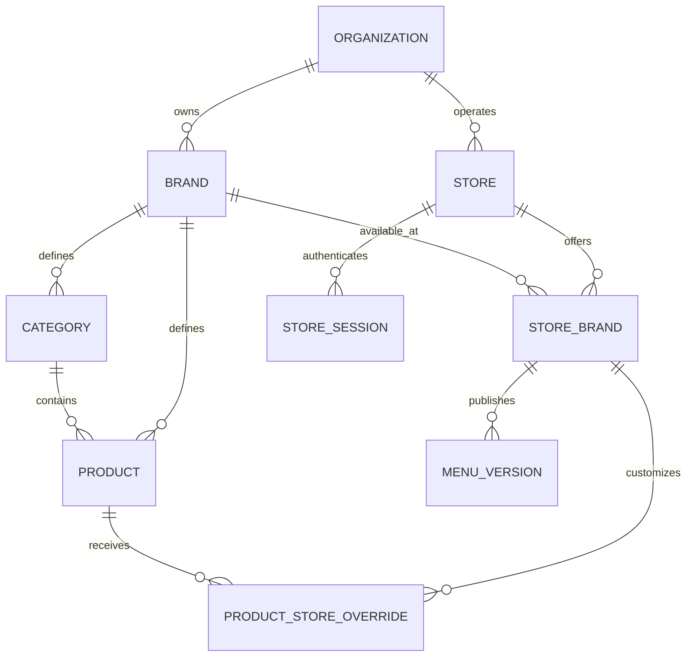

# Historical repository analysis

> This analysis predates the uploaded v4.2 plan. It records an earlier review and is not a current implementation status report.

# Multi-brand / multi-store analysis

Reviewed: 30 October 2026.

This reviews the supplied **Multi-Store Menu Platform.md** against the current repository. Its implementation instructions were treated as proposal content. This review changes documentation only; it does not implement the platform or inspect production records.

## 1. Recommendation and confirmed requirements

Keep the existing Express API, PostgreSQL/Prisma database, React admin, Flutter gallery, and Supabase admin authentication. Extend them around a **many-to-many relationship between physical stores and brands**.

The user confirmed:

- One physical store can offer several brands.
- Menus run on store-owned tablets.

The supplied proposal assumes each store belongs to exactly one brand. That assumption changes its schema, authorization, menu response, publishing, and tablet navigation. It needs revision before implementation.

Recommended initial ownership assumption: your business group controls the stores and brands. Represent that group with one `Organization`; there is no need to build organization onboarding in the first release. If unrelated business owners will share locations, define their ownership and access agreements before implementing the organization boundaries below.

## 2. What exists today

| Area | Evidence in this repository | Implication |
| --- | --- | --- |
| Backend | Express REST API in [server.js](../backend/server.js), PostgreSQL and Prisma 6 in [package.json](../backend/package.json) | The existing stack can support this expansion. |
| Data | [schema.prisma](../backend/prisma/schema.prisma) contains only `Category` and `Product`; neither has brand/store ownership | Every catalog operation needs an explicit scope. |
| Category identity | `Category.id` is globally unique; `Product.category` references it | Different brands cannot independently reuse a category code such as `drinks` without changing these constraints. |
| Money | `Product.price` is a string; [productController.js](../backend/controllers/productController.js) accepts formatted AED/EUR prices | Introduce an exact decimal amount and explicit currency. Preserve legacy formatting through an adapter. |
| Admin access | [requireAdmin.js](../backend/middleware/requireAdmin.js) verifies Supabase users and checks a global email allowlist | Authentication exists. Brand membership and organization roles do not. |
| Public catalog | `/api/products/available` and `/api/categories` are public in [productRoutes.js](../backend/routes/productRoutes.js) and [categoryRoutes.js](../backend/routes/categoryRoutes.js) | These are the actual legacy endpoints to constrain and eventually retire. There is no existing `/menu` route. |
| Queries | Product lists, category ordering/counts, and record mutations in the [controllers](../backend/controllers/productController.js) have no tenant scope | Adding a selector to the UI alone cannot isolate data. Counts and ordering queries also need scoping. |
| Admin cache | [App.js](../admin/src/App.js) keys `CatalogProvider` by user ID; [CatalogContext.js](../admin/src/data/CatalogContext.js) holds one catalog | Switching brands under the same account needs a new cache boundary and protection against late responses. |
| Settings | [Settings.js](../admin/src/components/Settings.js) simulates saving with timers | Brand/store configuration needs real persistence and API validation. |
| Tablet | [main.dart](../mobile/lib/main.dart) opens the gallery directly; [api_service.dart](../mobile/lib/services/api_service.dart) fetches categories and available products without authentication | Add store login, session management, and a resolved menu API. |
| Offline | [gallery_screen.dart](../mobile/lib/screens/gallery_screen.dart) stores catalog data in widget memory; image caching is present | Persistent offline menu data is a new feature. Cached images alone do not provide offline menus. |
| Branding | [constants.dart](../mobile/lib/utils/constants.dart) and the application theme contain Il Mio branding | Fetch brand identity and theme at runtime. Separate APK flavors can remain deferred. |
| Deployment | Mobile targets Vercel; Vercel configs and a Render blueprint both exist. [render.yaml](../render.yaml) runs `prisma db push` at startup | Confirm the active deployment path and introduce reviewed migrations. The checklist is not proof of current production infrastructure. |
| Maintenance scripts | [seed.js](../backend/scripts/seed.js) deletes all products; [seed_categories.js](../backend/scripts/seed_categories.js) deletes all categories; [update_prices.js](../backend/scripts/update_prices.js) updates by title | Retire or explicitly scope these scripts before multiple brands have data. |

The repository confirms Supabase **Auth** use. It does not establish that the application database is hosted by Supabase; the database connection comes from `DATABASE_URL`.

## 3. Revised domain model



For example, Store Downtown can offer Il Mio and Brand B. Store Marina can offer Il Mio alone. Both stores inherit Il Mio's base catalog. Downtown can override an Il Mio product's price or availability without affecting Marina or Brand B.

| Entity | Responsibility |
| --- | --- |
| `Organization` | Shared business ownership and organization administration. Start with one. |
| `Brand` | Name, logo, colors, default currency, catalog, and authorized brand administrators. |
| `Store` | Physical location, timezone, login code, password hash, status, token version, and aggregate menu revision. It has no single `brandId`. |
| `StoreBrand` | Explicit assignment of a brand to a physical store, with status, display order, and current published menu reference. Unique by store + brand. |
| `AdminProfile` / memberships | Map a verified Supabase user ID to organization and brand permissions. Do not duplicate Supabase passwords. |
| `Category` / `Product` | Brand-owned catalog. Preserve ingredients, image public IDs, and existing product identifiers. |
| `ProductStoreOverride` | A product's price/availability override for one `StoreBrand`. |
| `MenuVersion` | Immutable resolved menu for one `StoreBrand`; unique by assignment + version. |
| `StoreSession` | One tablet session, refresh-token state, expiry, and revocation. A generated installation ID can label a device; it is not an authentication credential. |
| `AuditLog` | Actor, organization, brand/store scope, action, timestamp, and a redacted change record. |

Keep existing CUID primary keys where practical. The proposal's UUID requirement does not justify replacing working product IDs during a tenant migration.

Move product relations toward the stable category primary key. Category codes should be unique within a brand. This lets both Il Mio and Brand B have a `drinks` category without collisions.

Use exact decimal money, initially at the precision required by the supported currencies, and serialize amounts as decimal strings in JSON. For an AED/EUR-only first release, two decimal places fit the existing amounts. Do not convert currencies during migration. Inventory existing price strings and resolve mixed or malformed values explicitly.

Use organization/brand columns and composite foreign keys where needed to ensure related rows belong together: a product's category must be in its brand; an override's product must match its assignment's brand; an assignment's brand and store must share the organization. Index the actual lookup paths, including assignment-first override reads. PostgreSQL supports multi-column foreign keys; independent foreign keys do not establish shared ownership. [PostgreSQL constraint documentation](https://www.postgresql.org/docs/current/ddl-constraints.html#DDL-CONSTRAINTS-FK).

Defer store-only categories in the first release. If store-only products are needed immediately, scope them to `StoreBrand` and enforce that ownership in both writes and menu resolution. Otherwise keep the first release to brand catalogs plus store overrides.

## 4. Authentication and permissions

Keep Supabase email/password authentication for human administrators. Replace the email allowlist with memberships keyed by verified Supabase user ID. Continue verifying identity server-side; Supabase documents `getUser(jwt)` as an authenticated server lookup. Resolve current permissions from application-owned records rather than editable user metadata. [Supabase getUser documentation](https://supabase.com/docs/reference/javascript/auth-getuser).

Recommended roles:

| Role | Allowed scope |
| --- | --- |
| Platform administrator | Platform operations and organization provisioning, if eventually needed. |
| Organization administrator | Own organization's stores, brand assignments, shared store passwords/devices, brand creation, and admin memberships. |
| Brand administrator | Assigned brand's catalog, branding, overrides, and publishing at stores offering that brand. |
| Store tablet session | Read the published menus for active brands assigned to its authenticated store. |

A brand administrator should not reset a shared physical store's password or revoke all its tablets. Those actions would disrupt other brands and belong to the organization administrator. A brand admin's store view should expose only location information needed for their own brand, without other brands' catalogs or credentials.

Implement store login separately from Supabase admin login. A store access token should identify its store/session and organization, with a store audience or realm. It must not contain a single authoritative `brandId`. Fetch active brand assignments server-side; a copied brand list in a long-lived token becomes stale after reassignment.

If an endpoint accepts a requested brand ID, treat it as a selector. Authorize it against the authenticated store's assignments or the admin's memberships before querying. For administrators allowed multiple brands, a URL selector plus a verified database membership is valid; the proposal's admin JWT does not itself contain the brand context it says to derive.

Use separate validation rules for Supabase admin tokens and store tokens. There is no need to make both realms share a signing key or rebuild admin authentication to obtain realm separation.

For custom store sessions, define access/refresh token purpose separation, refresh rotation with hashed server-side token state, logout revocation, and per-device revocation. Check store/session status and token version on authenticated store reads as well as refresh. Checking version only during refresh leaves existing access tokens usable until expiry. Preserve Supabase's own admin refresh lifecycle instead of assuming it follows the proposed custom 30-day format. [Supabase session documentation](https://supabase.com/docs/guides/auth/sessions).

Apply store-login limits through shared durable state, since the backend can run across serverless instances. Specify how the 5-failure window interacts with the 10-consecutive-failure lockout. Size the aggregate IP limit for multiple tablets sharing the same store internet connection.

## 5. Menu resolution and publishing

Keep server-side resolution, but resolve one **store-brand assignment** at a time:

1. Verify the store, brand, and assignment are active and authorized.
2. Load that brand's active categories/products.
3. Include store-only products for that assignment, if supported.
4. Apply only that assignment's overrides.
5. Produce the canonical snapshot with explicit brand identity, currency, and availability.

Separate draft resolution from delivery. Admin preview can resolve current draft data. Tablet reads should load the current published snapshots. Resolving live draft tables for every tablet request would let unpublished edits appear under an unchanged version.

Each publish should atomically create an immutable `MenuVersion`, advance that assignment's current published reference, increment the physical store's aggregate menu revision, and write a redacted audit entry. Serialize concurrent publishes or use an atomic counter/constraint with retry; `max(version) + 1` alone can race.

The authenticated `GET /api/menu` can return one store envelope containing its assigned brands and their published menus:

```json
{
  "schemaVersion": 2,
  "store": { "id": "store-downtown", "name": "Downtown" },
  "revision": 18,
  "brands": [
    {
      "id": "brand-ilmio",
      "name": "Il Mio Cioccolato",
      "currency": "AED",
      "menuVersion": 7,
      "categories": []
    },
    {
      "id": "brand-b",
      "name": "Brand B",
      "currency": "AED",
      "menuVersion": 3,
      "categories": []
    }
  ]
}
```

This shape is illustrative. Include logo/theme data and the existing product details in the real contract. Currency belongs to each brand menu, since a store no longer implies one brand/currency. Confirm whether international branches need a currency override on `StoreBrand`.

An aggregate revision must change when any visible menu is published or the visible brand assignment/configuration changes. Namespace the ETag by store and revision. Authenticate and authorize before returning `304`; a matching cache version must never bypass revocation. Configure private HTTP caching explicitly and keep persistent offline storage under app control.

Choose one availability rule. The proposal permits hiding unavailable products in one section but requires visible sold-out products in another. Recommended first release: inactive products are absent; sold-out products remain visible with a badge; local overrides cannot resurrect globally inactive products. Publish price/catalog/availability changes explicitly. If sold-out toggles need immediate delivery, implement an explicit publish-on-toggle path that also advances versions.

Shared brand edits should mark all affected assignments as having unpublished changes. Let a brand admin publish to selected stores or all stores offering that brand. A newly assigned brand should be activated for tablet display only once it has an initial published menu.

## 6. Admin and tablet changes

The admin needs an organization store-management view, a brand selector, and a store selector limited to locations offering the selected brand. Distinguish base catalog edits from local overrides and show unpublished changes. Persist branding, currency, timezone, and other supported settings through real endpoints.

Partition the admin catalog cache by authenticated user, organization, brand, and any selected store context. Clear edit forms and discard outstanding responses when the context changes. The current user-only provider key cannot protect a same-user brand switch by itself. Apply the same context to upload signing, asset records, audit reads, counts, and batch operations. Cloudinary folders can help organize assets, but they do not enforce authorization.

Recommended tablet flow:

```text
Store login -> this store's brands -> selected brand's categories/menu
```

With one assigned brand, enter its gallery directly. With several, offer brand cards or tabs and preserve the existing slideshow/gallery within a brand. This allows brand selection inside the authenticated physical store; it does not expose a store picker. Whether individual tablets must be locked to one assigned brand remains a product decision.

Store refresh credentials using a Flutter abstraction backed by platform secure storage. Add a persistent cache bound to organization + store, with separate brand/assignment menu versions and payload schema version. Keep products, category state, selected brand, and asynchronous responses within the same session boundary. Logout clears that boundary; an online assignment removal also removes that brand's cached menu.

Define offline behavior separately from invalid credentials. A timeout or temporary server failure should retain the authorized store's cached menu within an agreed offline window. An explicit revoked/invalid session should clear protected data after the refresh policy is exhausted. The proposal's requirement to refresh successfully on every startup conflicts with reopening offline.

Immediate server revocation cannot be observed by an offline tablet. Choose the permitted offline duration before implementation and describe revocation as immediate on the next online check, subject to that offline window. Also decide whether offline operation requires pre-downloading images; URL image caching does not guarantee every menu image is available.

Reuse the existing [APK updater](../mobile/lib/services/app_updater.dart) for migration. Preserve the installed app's package identity and signing continuity if using in-place updates. A shared APK can still show each brand's runtime identity; its launcher identity needs a separate platform-level decision.

## 7. Changes required in the supplied proposal

| Proposal assumption/gap | Required revision |
| --- | --- |
| `stores.brand_id` and brand-derived store login | Physical stores plus `StoreBrand` assignments; login codes identify physical locations. |
| One `brandId` in store JWT and one brand in login/menu response | Store/session identity plus server-authorized assigned brands; aggregate store envelope. |
| Brand admins own store credentials | Organization administrator controls shared store credentials and device sessions. |
| Rebuild admin users/passwords | Keep Supabase identities; add application memberships and role checks. |
| Live `resolveMenu()` and immutable published snapshots are both described | Resolve drafts for preview/publish; deliver published snapshots to tablets. |
| Version is only per store, without multi-brand assignment behavior | Assignment menu versions plus a physical store revision for aggregate sync. |
| Store-only categories promised but absent from schema | Defer them or model them explicitly. |
| Hide unavailable versus display sold-out | Select explicit inactive/sold-out semantics and publish timing. |
| Refresh required at startup plus offline restart | Define an offline authorization/cache window and distinguish network failures from invalid sessions. |
| Token version checked only at refresh | Validate current status/version on protected reads for online revocation guarantees. |
| Same-key access/refresh JWTs without token-purpose rules | Define purpose/audience checks and session rotation; retain Supabase's separate admin lifecycle. |
| Legacy public `/menu` migration | Scope the actual legacy `/api/products/available` and `/api/categories` endpoints. |
| Brand ID header on every response | Use store scope for aggregate responses and brand scope only for a selected brand. Pre-auth responses have no authorized brand context. |
| No cross-store data in screenshots | Test controlled UI/cache/log behavior; logout cannot erase screenshots already taken outside app control. |

## 8. Migration sequence

1. **Finalize the revised contract.** Confirm shared ownership, tablet brand selection, offline duration, supported currencies, and publish behavior. Update the supplied acceptance criteria for many brands per store.
2. **Prepare migrations and recovery.** Back up and rehearse restoring the database. Confirm the actual production host and baseline the existing Prisma schema before introducing migration history. Prisma documents baselining specifically for databases whose existing data must be retained. [Prisma 6 baselining guide](https://www.prisma.io/docs/orm/v6/prisma-migrate/workflows/baselining).
3. **Expand and backfill.** Create the default organization, Il Mio brand, existing physical store, and their assignment. Preserve catalog IDs and images; map current administrators to explicit roles. Convert validated prices without currency conversion. Initially add ownership fields in a backward-compatible way, backfill, then enforce constraints after all deployed writers populate them.
4. **Close legacy scope before adding other brands' data.** Pin both legacy public endpoints to the original store-brand assignment and preserve their existing JSON shape, category codes, and price strings. Keep new brands out of these queries. Retire or scope global maintenance scripts.
5. **Implement authorization, sessions, and publish together.** Add organization/brand guards, store login, durable rate limits, session revocation, server-side resolution, initial published snapshots, and audit writes. Test these before exposing new administration screens.
6. **Extend the React admin.** Add store/brand assignments, scoped catalog operations, overrides, real settings, preview, and publish. Preserve current catalog performance behavior while adding cache boundaries.
7. **Ship the authenticated Flutter build.** Add secure login, assigned-brand navigation, runtime branding, sold-out display, conditional sync, persistent cache, and logout. Rehearse an upgrade on an existing tablet and switching between two physical stores.
8. **Pilot and sunset.** Pilot with one store offering two brands and another offering one. Log legacy route traffic, track installed build adoption, and retire public catalog access after confirmed migration. Use reviewed deployment migrations instead of schema synchronization at application startup.

The legacy adapter is a temporary exception to authenticated catalog access. It must remain fixed to the original store-brand menu throughout the rollout. Keep the non-catalog APK version endpoint available if required by the existing updater.

## 9. Acceptance tests specific to this requirement

- Downtown has Il Mio + Brand B; Marina has Il Mio. Downtown sees both; Marina cannot request Brand B by altering IDs.
- Another organization's brands, stores, assignments, assets, and menus are inaccessible.
- A brand administrator cannot read/write another brand's catalog, counts, overrides, snapshots, or audit entries, including at the same physical store.
- A brand administrator cannot reset a shared store password or revoke other brands' tablet access.
- Both brands can have a `drinks` category; products cannot be attached across brand boundaries.
- Il Mio's Downtown price/sold-out override changes neither Marina nor Brand B.
- Unpublished edits stay off tablets. Publish changes only the intended assignments and advances the aggregate revision correctly.
- Concurrent publishes produce unique ordered versions and a consistent current snapshot.
- Adding/removing a brand invalidates the aggregate ETag; online access removal also clears its tablet cache.
- Store tokens fail on admin routes; admin tokens fail on tablet menu routes. Refresh credentials cannot serve as access credentials.
- Password reset, per-device revocation, and store deactivation reject online reads even with previously issued access tokens.
- Store switch/logout and same-user admin brand switches cannot display old data or accept late responses into the new context.
- Offline restart works within the chosen policy. Network failure preserves the correct cache; confirmed invalid credentials follow the re-login policy.
- The old APK sees only the original Il Mio menu after other stores/brands are created.
- The migration preserves product/category mapping, prices, ingredients, images, and ordering; production backup restoration has been rehearsed.

Current tests cover existing authentication/error handling, upload signing, catalog performance, account isolation, and price/UI behavior. They do not establish these future multi-brand guarantees. No application test run is claimed by this documentation-only review, and the proposal's latency target has not been measured for the new design.

## 10. Remaining product decisions

- Are all brands and stores controlled by your business group, or can independent owners share a location?
- Does every tablet show all assigned brands, or should an administrator lock some tablets to one brand?
- How long may a previously authorized tablet keep operating offline?
- Do availability changes require immediate publish, and are store-only products needed in the first release?
- Are all branches using the brand's default currency, and when can the old public endpoints be retired?
