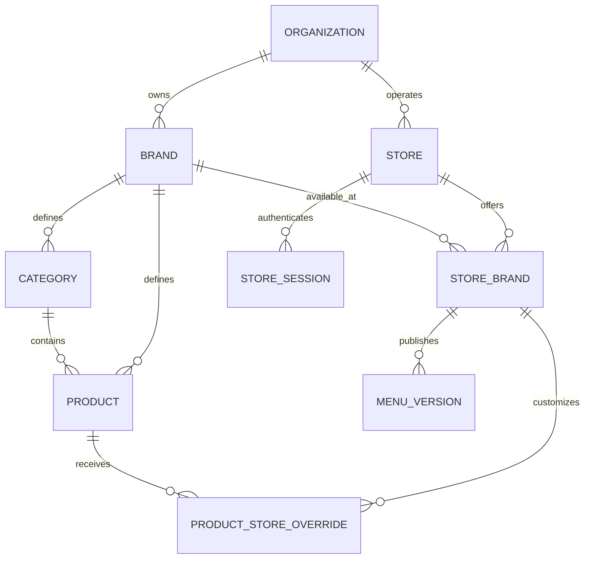

# Superseded specification: Multi-Brand / Multi-Store Menu Platform

> This earlier draft is retained for history. The uploaded v4.2 plan supersedes it; use the current deployment and adoption runbooks for operational steps.

# SPEC: Multi-Brand / Multi-Store Menu Platform (v3 — Merged, M:N corrected)

> Single consolidated spec. Supersedes all earlier versions. Incorporates the repository
> review (Oct 2026): many-to-many store↔brand, real stack (Express + Prisma + PostgreSQL,
> React admin, Flutter tablet, Supabase admin auth), and the corrections in §7 of the review.
> Where any earlier draft contradicted this file, this file wins.

**Feed to agent:**
> You are implementing the spec below in the existing repository. Do not replace the stack
> (Express, Prisma 6, PostgreSQL, React, Flutter, Supabase auth) — extend it. Start with §17
> (Build Order). After each step, run the matching acceptance criteria in §15 and report
> status. If any assumption in §2 is false for this repo, pause and ask before coding.

---

## 1. Context

Current system: single-brand menu platform (Il Mio). Express REST API, PostgreSQL via Prisma 6,
React admin, Flutter tablet gallery, Supabase admin authentication. Backend today has only
`Category` and `Product` with no tenant scope; public catalog endpoints; tablet opens the
gallery with no login; seed scripts delete all rows.

Target: **N brands × M physical stores**, where **each physical store can offer multiple brands**
(many-to-many). Store-owned tablets log in per physical store and display the published menus
for the brands assigned to that store. All catalog, override, menu, session, and audit data is
strictly isolated per brand/organization.

## 2. Confirmed requirements & existing stack (verify before coding)

Confirmed with the product owner:
- One physical store can offer several brands.
- Menus run on store-owned tablets.
- Business group controls all stores and brands initially (one `Organization`).

Existing stack to preserve:
- Backend: Express + PostgreSQL + Prisma 6
- Admin: React
- Mobile: Flutter (currently a gallery that hits public endpoints)
- Admin authentication: Supabase email/password (replace the current email allowlist with
  membership records; do not duplicate Supabase passwords)
- Money: currently a `String` accepting formatted AED/EUR — migrate to exact decimal + explicit
  currency, adapt legacy formatting
- Deployment: reconcile Vercel and Render paths; introduce reviewed Prisma migrations
  (do **not** rely on `prisma db push` at startup in production)

Deferred to later phases:
- Multiple organizations (schema supports it; only one in v1)
- Store-only categories (brand catalogs + per-assignment overrides are enough for v1)
- White-label APK flavors
- Immediate sold-out push (explicit publish path in v1)
- Cross-brand currency overrides on `StoreBrand` (decide later; brand currency in v1)

## 3. Domain Model (corrected to many-to-many)



Example: Store Downtown offers Il Mio + Brand B. Store Marina offers Il Mio only. Both inherit
Il Mio’s base catalog. Downtown can override an Il Mio product’s price or availability without
affecting Marina or Brand B.

## 4. Roles / RBAC

| Role | Scope |
| --- | --- |
| Platform administrator | Platform operations and organization provisioning (deferred). |
| Organization administrator | Own organization’s stores, brand assignments, shared store credentials, device/session revocation, admin memberships. |
| Brand administrator | Assigned brand’s catalog, branding, per-store overrides, publishing at stores offering that brand. **Cannot** reset shared store passwords or revoke other brands’ tablets. |
| Store tablet session | Read published menus for **active brands assigned to its authenticated store**. |

Rules:
- Admin requests: brand/org scope derived from **verified membership records**, not from
  request params. If a URL carries a `brandId`/`storeId`, treat it as a **selector** — authorize
  it against the caller’s memberships before querying.
- Store requests: `storeId` derived from the store session token; any brand selection on a
  store request is authorized against the store’s current assignments.
- Never trust `brandId`/`storeId` from request params/body for scoping.

## 5. Database Schema (Prisma-style; adapt to schema.prisma)

Keep existing CUID primary keys where practical. Do **not** replace working product IDs during
tenant migration. Use composite foreign keys (or app-level invariants plus DB checks) to
enforce that related rows share ownership; independent FKs do not.

```prisma
model Organization {
  id        String   @id @default(cuid())
  name      String
  status    String
  createdAt DateTime @default(now())
  updatedAt DateTime @updatedAt
  brands    Brand[]
  stores    Store[]
}

model Brand {
  id        String   @id @default(cuid())
  orgId     String
  slug      String
  name      String
  logoUrl   String?
  primaryColor String?
  currency  String   // ISO 4217, e.g. "AED"
  timezone  String
  status    String
  createdAt DateTime @default(now())
  updatedAt DateTime @updatedAt

  org           Organization  @relation(fields: [orgId], references: [id])
  categories    Category[]
  products      Product[]
  assignments   StoreBrand[]
  memberships   BrandMembership[]

  @@unique([orgId, slug])
}

model Store {
  id            String   @id @default(cuid())
  orgId         String
  name          String
  slug          String
  address       String?
  phone         String?
  lat           Float?
  lng           Float?
  timezone      String
  status        String
  // Store login (shared per physical store)
  loginCode     String   @unique        // e.g. "downtown"
  passwordHash  String                  // argon2id
  tokenVersion  Int      @default(0)    // bump to revoke all sessions
  // Aggregate menu revision – bumps when any visible menu/assignment changes
  revision      Int      @default(0)
  lastLoginAt   DateTime?
  failedLogins  Int      @default(0)
  lockedUntil   DateTime?
  createdAt     DateTime @default(now())
  updatedAt     DateTime @updatedAt

  org         Organization  @relation(fields: [orgId], references: [id])
  assignments StoreBrand[]
  sessions    StoreSession[]

  @@unique([orgId, slug])
}

model StoreBrand {
  id              String   @id @default(cuid())
  storeId         String
  brandId         String
  displayOrder    Int      @default(0)
  status          String                 // "active" | "inactive"
  currentMenuVersionId String?           // latest published MenuVersion for this assignment
  unpublishedChanges   Boolean @default(false)
  createdAt DateTime @default(now())
  updatedAt DateTime @updatedAt

  store       Store  @relation(fields: [storeId], references: [id])
  brand       Brand  @relation(fields: [brandId], references: [id])
  overrides   ProductStoreOverride[]
  menus       MenuVersion[]

  @@unique([storeId, brandId])
}

// Admin users: app-owned profile keyed to Supabase user id.
model AdminProfile {
  id             String   @id @default(cuid())
  supabaseUserId String   @unique
  email          String
  name           String?
  isPlatformAdmin Boolean @default(false)
  status         String
  createdAt      DateTime @default(now())
  updatedAt      DateTime @updatedAt

  brandMemberships BrandMembership[]
  orgMemberships   OrgMembership[]
}

model OrgMembership {
  id        String @id @default(cuid())
  profileId String
  orgId     String
  role      String   // "ORG_ADMIN"
  createdAt DateTime @default(now())

  @@unique([profileId, orgId])
}

model BrandMembership {
  id        String @id @default(cuid())
  profileId String
  brandId   String
  role      String   // "BRAND_ADMIN"
  createdAt DateTime @default(now())

  profile AdminProfile @relation(fields: [profileId], references: [id])
  brand   Brand        @relation(fields: [brandId], references: [id])

  @@unique([profileId, brandId])
}

model Category {
  id        String  @id @default(cuid())
  brandId   String
  code      String   // unique *per brand*, e.g. "drinks"
  name      String
  sortOrder Int     @default(0)
  imageUrl  String?
  isActive  Boolean @default(true)
  createdAt DateTime @default(now())
  updatedAt DateTime @updatedAt

  brand    Brand     @relation(fields: [brandId], references: [id])
  products Product[]

  @@unique([brandId, code])   // allows Il Mio and Brand B to both have "drinks"
}

model Product {
  id          String   @id @default(cuid())
  brandId     String
  categoryId  String
  name        String
  description String?
  priceAmount Decimal  @db.Decimal(10, 2)   // exact decimal; serialize as string in JSON
  currency    String                         // ISO 4217 (inherits brand; denormalized for safety)
  imageUrl    String?
  imagePublicId String?
  ingredients String?
  isActive    Boolean  @default(true)
  sortOrder   Int      @default(0)
  metadata    Json?
  createdAt   DateTime @default(now())
  updatedAt   DateTime @updatedAt

  brand     Brand     @relation(fields: [brandId], references: [id])
  category  Category  @relation(fields: [categoryId], references: [id])
  overrides ProductStoreOverride[]
  // DB-level: enforce category.brandId = product.brandId (composite FK or CHECK).
}

model ProductStoreOverride {
  id           String   @id @default(cuid())
  storeBrandId String
  productId    String
  priceAmount  Decimal? @db.Decimal(10, 2)
  isSoldOut    Boolean?
  updatedAt    DateTime @updatedAt

  storeBrand StoreBrand @relation(fields: [storeBrandId], references: [id])
  product    Product    @relation(fields: [productId], references: [id])

  @@unique([storeBrandId, productId])
  // Invariant: product.brandId must equal storeBrand.brandId (enforce in app + DB).
}

model MenuVersion {
  id           String   @id @default(cuid())
  storeBrandId String
  version      Int
  snapshot     Json      // immutable resolved menu for this assignment
  publishedBy  String?
  publishedAt  DateTime @default(now())

  storeBrand StoreBrand @relation(fields: [storeBrandId], references: [id])

  @@unique([storeBrandId, version])
}

model StoreSession {
  id           String   @id @default(cuid())
  storeId      String
  refreshHash  String                 // argon2/bcrypt of refresh token
  deviceLabel  String?
  ip           String?
  expiresAt    DateTime
  revokedAt    DateTime?
  createdAt    DateTime @default(now())
  lastSeenAt   DateTime @default(now())

  store Store @relation(fields: [storeId], references: [id])

  @@index([storeId])
}

model LoginAttempt {
  id         String   @id @default(cuid())
  realm      String   // "store" | "admin"
  identifier String   // loginCode or email
  ip         String?
  success    Boolean
  at         DateTime @default(now())

  @@index([identifier, at])
}

model AuditLog {
  id          String   @id @default(cuid())
  actorType   String   // "admin" | "store" | "system"
  actorId     String?
  orgId       String?
  brandId     String?
  storeId     String?
  entity      String
  entityId    String
  action      String
  diff        Json?    // redacted change record
  at          DateTime @default(now())

  @@index([brandId, at])
  @@index([storeId, at])
}
```

Schema notes:
- Composite FK / invariant: `Product.categoryId` must be a category of the same `brandId`.
- Composite FK / invariant: `ProductStoreOverride.productId` brand must equal
  `storeBrand.brandId`.
- `MenuVersion.snapshot` is written once and never mutated.
- `Store.revision` increments on any publish or assignment change visible to that store.
- Indexes: at minimum `StoreBrand(storeId)`, `ProductStoreOverride(storeBrandId, productId)`,
  `Category(brandId, sortOrder)`, `Product(brandId, categoryId)`.

## 6. Menu Resolution & Publishing

Resolve **one StoreBrand assignment at a time**, and separate **draft** from **published**:

1. Verify store, brand, and assignment are active and authorized.
2. Load that brand’s active categories and active products (sorted).
3. Apply **only that assignment’s** overrides (`priceAmount` override, `isSoldOut`).
4. Produce a canonical snapshot with explicit `brandId`, `currency`, and per-item
   `availability: "available" | "soldout"`.

**Draft resolve** — used for admin preview and for the publish step. Reads live tables.

**Published read** — used by tablets. Reads `StoreBrand.currentMenuVersionId` → `MenuVersion.snapshot`.
Never resolve live draft tables on tablet reads; unpublished edits must not appear.

**Publish** (atomic, serialized):
- Creates an immutable `MenuVersion` row for that assignment (next version number).
- Advances `StoreBrand.currentMenuVersionId` and clears `unpublishedChanges`.
- Increments `Store.revision` for the physical store.
- Writes an audit entry (redacted diff).

Use an atomic counter or a unique constraint with retry — `max(version)+1` alone races.

**Availability semantics (choose these; do not mix):**
- `isActive=false` → item is **absent** from the resolved menu.
- `isSoldOut=true` (via override) → item is **present with a sold-out badge**.
- A local override cannot resurrect a globally inactive product.

**Unpublished edits:** any brand admin edit to catalog, override, or assignment marks all
affected `StoreBrand.unpublishedChanges = true`. A brand admin may publish to one, several, or
all stores offering that brand. A newly assigned brand shows on tablets only after its first
publish.

## 7. Authentication & Sessions

### Admin (Supabase — keep)
- Supabase email/password; verify server-side on every admin request.
- **Replace the email allowlist** with `AdminProfile` + `BrandMembership` / `OrgMembership`
  lookups keyed by verified Supabase user ID.
- Permissions resolved from application-owned records, not user-editable metadata.
- Preserve Supabase’s refresh lifecycle — do not force it into the store realm’s custom format.

### Store tablet login (custom)
```
POST /api/auth/store/login
  body { loginCode, password }
  200 → { accessToken, refreshToken,
          store: { id, name, orgId },
          brands: [ { id, name, slug, logoUrl, currency, menuVersion } ] }
```
Rules:
- Durable rate limit (DB- or Redis-backed, works across serverless instances):
  5 failures / 15 min per `loginCode` and per IP — **whichever is more restrictive**.
  10 consecutive failures → `lockedUntil = now() + 30 min` and reset the counter.
  Documented interaction: the 5/15m window throttles; the 10-consecutive rule triggers a
  hard lock.
- `failedLogins++` on failure; `failedLogins=0`, `lastLoginAt=now()` on success.
- Constant-time password comparison even when the code is unknown.
- **Identical 401** for bad code vs bad password.
- On success create a `StoreSession` row; hash the refresh token for storage.

Store access JWT claims (no `brandId`):
```
{ realm: "store", storeId, orgId, sessionId, tokenVersion, aud: "store", exp }
```
Store refresh token:
- Purpose-separated (refresh-only), rotated on each refresh, hashed server-side.
- `POST /api/auth/store/refresh` validates: session not revoked/expired, store active,
  `tokenVersion` matches.
- `POST /api/auth/store/logout` revokes the current session.
- **Check `tokenVersion` and session status on every protected store read** (not just
  refresh) so password reset / per-device revoke / store deactivation takes effect
  immediately online.

Cross-realm: store tokens rejected on admin routes; admin (Supabase) tokens rejected on
store routes. Do not share signing keys; use separate validation.

## 8. API Surface (adapted to existing `/api` prefix)

**Public**
```
GET  /healthz
```
Existing legacy endpoints (temporary; see §12):
```
GET  /api/categories               (legacy — pinned to original assignment)
GET  /api/products/available       (legacy — pinned to original assignment)
GET  /api/app/version              (keep if the existing APK updater needs it)
```

**Store realm (custom JWT, `aud="store"`)**
```
POST /api/auth/store/login
POST /api/auth/store/refresh
POST /api/auth/store/logout
GET  /api/menu
       → aggregate envelope for the authenticated store’s published menus
       → ETag namespaced by storeId + revision
       → 401 if no/invalid token
```
`GET /api/menu` response (illustrative — include logo/theme/product detail in the real contract):
```json
{
  "schemaVersion": 2,
  "store": { "id": "store-downtown", "name": "Downtown" },
  "revision": 18,
  "brands": [
    { "id": "brand-ilmio", "name": "Il Mio Cioccolato", "currency": "AED",
      "menuVersion": 7, "categories": [] },
    { "id": "brand-b",     "name": "Brand B",           "currency": "AED",
      "menuVersion": 3, "categories": [] }
  ]
}
```
Authenticate and authorize **before** returning `304`. A matching cache must never bypass
revocation.

**Admin realm (Supabase JWT + membership check)**
```
GET    /api/admin/me
GET    /api/admin/orgs
CRUD   /api/admin/orgs/:orgId/stores
CRUD   /api/admin/orgs/:orgId/brand-assignments       (attach/detach brand↔store)
POST   /api/admin/orgs/:orgId/stores/:storeId/password       (org admin only)
POST   /api/admin/orgs/:orgId/stores/:storeId/revoke-devices (org admin only)
GET    /api/admin/orgs/:orgId/stores/:storeId/login-qr       (org admin only)

CRUD   /api/admin/brands/:brandId/categories
CRUD   /api/admin/brands/:brandId/items
CRUD   /api/admin/brands/:brandId/settings            (logo, currency, timezone, colors)
GET    /api/admin/brands/:brandId/stores              (stores offering this brand)
PUT    /api/admin/brands/:brandId/stores/:storeId/items/:itemId/override
GET    /api/admin/brands/:brandId/stores/:storeId/preview  (draft resolve)
POST   /api/admin/brands/:brandId/stores/:storeId/publish
POST   /api/admin/brands/:brandId/publish             (publish to selected/all assignments)
GET    /api/admin/brands/:brandId/audit-log
```
Errors: RFC 7807 `problem+json`. Use store scope for aggregate responses; brand scope only
for brand-scoped responses. Pre-auth responses have no authorized brand context.

## 9. Admin (React) Changes

- Add **Organization → Store management** view: create store, set login code + password,
  reset password, revoke device sessions, show login QR, manage brand assignments.
- Add a **brand selector** and a **store selector limited to stores offering the selected brand**.
- Distinguish **base catalog** edits from **per-store overrides**; show `unpublishedChanges`
  badges per store/brand.
- Add **Preview** (draft resolve) and **Publish** (to selected / all) actions.
- Replace simulated `Settings.js` with real persistence for logo, colors, currency, timezone.
- **Cache partition** by `profileId + orgId + brandId + storeId`. Current user-only provider
  key is insufficient for same-user brand switches.
- On context change: clear edit forms, discard outstanding responses, ignore stale callbacks.
- Apply the same context to upload signing, asset records, audit reads, counts, and batch ops.
  Cloudinary folders help organize assets but do **not** enforce authorization.
- Real auth flow: replace the email allowlist with membership-based authorization.

## 10. Tablet (Flutter) Changes

- **Login screen**: Store ID (login code) + password. Errors: generic “Invalid store ID or
  password”; on 429/locked, show retry-after.
- **Brand selection**: after login, show the store’s assigned brands (cards/tabs). If only
  one assigned brand, enter its gallery directly. No store picker anywhere.
- **Gallery**: unchanged slideshow/category UI, now driven by the authenticated
  `GET /api/menu` envelope (per-brand sections).
- **Runtime branding**: fetch brand logo/colors/currency from the menu envelope; remove
  hard-coded Il Mio constants from `constants.dart` (or drive them from the payload).
- **Secure storage**: use a Flutter abstraction backed by platform secure storage
  (`flutter_secure_storage` or equivalent) for refresh tokens — never plain SharedPreferences.
- **Persistent cache**: JSON menu cache bound to `orgId + storeId`, with separate per-brand
  versions and a `schemaVersion` field. Logout clears it. Online assignment removal also
  removes that brand from cache.
- **Session boundary**: products, categories, selected brand, and async responses must not
  leak across a store switch or logout.
- **Keep `app_updater.dart`** for migration; preserve package identity and signing continuity
  for in-place updates.
- **Offline behaviour** (§11): timeout preserves cache within the offline window; explicit
  revoked/invalid session clears protected data after refresh is exhausted.

## 11. Sync & Offline Policy

- Envelope carries a store-level `revision` and per-brand `menuVersion`.
- Tablet sends `If-None-Match` (ETag namespaced `store:{storeId}:rev:{revision}`). **Auth is
  validated before 304.**
- Background sync on foreground + every N minutes.
- **Offline window** — define explicitly before implementation (product decision, §18).
  Recommendation: allow offline use of the last authorized cached menu for up to **72 hours**.
  - Network failure / timeout → keep cache; retry quietly.
  - Refresh rejected / session revoked → clear protected data and force re-login.
- Image pre-download decision: URL caching does **not** guarantee every image is available
  offline. If offline image display matters, add a pre-download step bound to the current
  menu version. Otherwise document that images may be missing offline.
- Immediate server revocation cannot reach an offline device. Document as: “effective on
  next online check, subject to the offline window”.

## 12. Migration Sequence (from single-brand)

1. **Finalize contract** — confirm shared ownership, tablet brand selection, offline
   duration, supported currencies, publish behaviour. Update acceptance criteria (§15) for
   many-brands-per-store.
2. **Backups and baseline** — back up the DB, rehearse restore, baseline the existing Prisma
   schema so migrations can be introduced without data loss. Confirm the live production
   host and deployment path.
3. **Expand and backfill** — add ownership fields (nullable); create default `Organization`,
   `Brand` for Il Mio, `Store` for the existing physical location, and the `StoreBrand`
   assignment. Map current admins to `AdminProfile` + `BrandMembership`. Convert validated
   prices to `Decimal` with explicit currency; do not convert currencies.
4. **Enforce constraints** — after all deployed writers populate ownership, make fields
   `NOT NULL`, add composite FKs / invariants, and unique constraints
   (`Category @@unique([brandId, code])`, `StoreBrand @@unique([storeId, brandId])`,
   `ProductStoreOverride @@unique([storeBrandId, productId])`).
5. **Pin legacy endpoints** — `/api/products/available` and `/api/categories` remain public
   temporarily, fixed to the original store-brand assignment, preserving existing JSON shape,
   category codes, and price strings. **New brands must not appear here.**
6. **Retire/scope maintenance scripts** — `seed.js`, `seed_categories.js`, `update_prices.js`
   currently wipe or bulk-edit data. Move under a `dev` scope or delete. Do not run against
   shared data.
7. **Implement auth + sessions + publish together** — org/brand guards, store login, durable
   rate limits, session revocation, server-side resolution, initial published snapshots,
   audit writes. Test before exposing new admin screens.
8. **Extend React admin** — assignments, scoped catalog, overrides, real settings, preview,
   publish, cache boundaries.
9. **Ship authenticated Flutter build** — secure login, brand navigation, runtime branding,
   sold-out display, persistent cache, logout, conditional sync.
10. **Pilot and sunset** — pilot one store with two brands and one with one brand. Log
    legacy traffic, track installed-build adoption, retire public catalog access and the
    legacy adapter after confirmed migration. Keep `/api/app/version` for the updater if
    required.

## 13. Non-Functional

- Tenant isolation: automated matrix test — org admin of A, brand admin of A cannot reach B’s
  rows (403/404) across catalog, overrides, menus, audit, assets, sessions.
- `GET /api/menu` P95 < 200 ms with 10k items; index the lookup paths in §5.
- Durable rate limits for store login (works across serverless instances).
- Every admin write → audit log (redacted diff).
- Daily full backups + WAL archiving; restore rehearsed.
- No PII in menu snapshot; no plaintext or hashes in logs.
- Reviewed Prisma migrations only; `prisma db push` not used in production.

## 14. Security Checklist

- [ ] argon2id hashing for store passwords and refresh tokens.
- [ ] Store login rate limits (5/15m per code + per IP; 10 consecutive → 30m lock) tested
      with multiple concurrent server instances.
- [ ] Identical 401 body for bad code vs bad password.
- [ ] Store tokens fail on admin routes; Supabase admin tokens fail on `/api/menu`.
- [ ] Refresh token cannot be used as access token (audience/purpose claim).
- [ ] `tokenVersion` + session status checked on every protected store **read**, not only
      refresh; password reset and revoke-devices take effect on next online read.
- [ ] `brandId`/`storeId` always from JWT + membership, never from request params alone.
- [ ] Composite FK / invariant: product’s category is in the same brand; override’s product
      is in the assignment’s brand.
- [ ] HTTP caching private; 304 never bypasses auth.
- [ ] Flutter tokens in secure storage; cache wiped on logout.
- [ ] Admin UI ignores late responses across brand/store context switches.
- [ ] Legacy endpoints pinned and monitored; only original assignment exposed.
- [ ] `seed*.js` and `update_prices.js` cannot run against shared/production data.
- [ ] Menu endpoint returns 401 without a store token.

## 15. Acceptance Criteria

**Store + brands (M:N)**
- [ ] Downtown has Il Mio + Brand B; Marina has Il Mio. Downtown sees both; Marina cannot
      request Brand B by altering IDs.
- [ ] A second organization’s brands, stores, assignments, assets, and menus are inaccessible.
- [ ] Both brands can have a category with code `drinks`; products cannot attach across brand
      boundaries.
- [ ] Il Mio’s Downtown price/sold-out override changes neither Marina nor Brand B.
- [ ] Adding/removing a brand changes the store’s aggregate `revision`; ETag invalidates;
      online removal also clears the tablet’s cached brand.

**Auth & sessions**
- [ ] Wrong store password → generic 401; 6th attempt → 429 / locked.
- [ ] Admin token on `/api/menu` → 403; store token on `/api/admin/*` → 403.
- [ ] Store password reset, per-device revoke, or store deactivation rejects online reads
      even with a previously issued access token.
- [ ] Brand admin cannot reset shared store password or revoke other brands’ tablets.
- [ ] Brand admin of Acme cannot read/write Ember catalog, counts, overrides, snapshots,
      audit entries — including at the same physical store.

**Menus & publishing**
- [ ] Unpublished edits never appear on tablets until a publish.
- [ ] Publish creates an immutable `MenuVersion`, advances `currentMenuVersionId`, increments
      the store `revision`, writes audit; tablet gets 200 with new ETag; otherwise 304.
- [ ] Concurrent publishes produce unique, ordered versions and a consistent current snapshot.
- [ ] `isActive=false` → absent on tablets; `isSoldOut=true` → visible with badge.
- [ ] Local override cannot resurrect a globally inactive product.

**Admin UI**
- [ ] Same-user brand/store switch cannot display old data or accept stale responses into the
      new context.
- [ ] Settings persist through real endpoints (no simulated save).
- [ ] Org admin can create a store, set/reset password, revoke devices, print login QR.
- [ ] Brand admin can publish to selected stores or all stores offering the brand.

**Tablet / offline**
- [ ] Login → assigned brands → gallery; with one brand, straight to gallery.
- [ ] Logout and store switch clear the correct cache; no cross-store data leaks.
- [ ] Offline restart works within the defined window. Network failure preserves cache;
      confirmed invalid credentials force re-login.

**Migration**
- [ ] Existing Il Mio catalog, prices, ingredients, images, and ordering are preserved.
- [ ] Old APK build sees only the original Il Mio menu after other brands/stores exist.
- [ ] Production backup restore rehearsed.
- [ ] Reviewed migrations applied; `prisma db push` not used in prod.

## 16. Out of Scope (v1)

- Multiple organizations (schema ready; not required)
- Store-only categories (defer; brand catalog + overrides is enough)
- Immediate sold-out push (explicit publish path in v1)
- Per-brand APKs / white-label flavors
- Per-user staff logins under a store
- Cross-brand currency overrides on `StoreBrand`
- SEO web menu, payments, POS

## 17. Build Order

1. Confirm remaining product decisions (§18); update acceptance criteria if any change.
2. Backups + Prisma baseline + reviewed migration tooling (§12.2).
3. Schema expansion and backfill (Organization, Brand, Store, StoreBrand, AdminProfile,
   memberships, ProductStoreOverride, MenuVersion, StoreSession, LoginAttempt, AuditLog);
   Decimal money + explicit currency (§5, §12.3–12.4).
4. Composite constraints and indexes; category-per-brand uniqueness; cross-brand attach
   blocked.
5. Pin legacy `/api/products/available` and `/api/categories` to the original assignment;
   scope or retire maintenance scripts (§12.5–12.6).
6. Auth: Supabase admin membership check (replace email allowlist); custom store login +
   refresh rotation + revocation + durable rate limits; cross-realm rejection (§7).
7. `resolveMenu` (draft + published) and `GET /api/menu` aggregate envelope; publish path;
   audit writes (§6, §8).
8. React admin: assignments, brand/store selectors, overrides, real settings, preview,
   publish, cache partition (§9).
9. Flutter: secure login, brand navigation, runtime branding, sold-out UI, persistent cache,
   logout, conditional sync, offline window (§10, §11).
10. Security checklist (§14) and acceptance tests (§15).
11. Pilot two stores (one with two brands, one with one) and sunset legacy (§12.10).

## 18. Open Questions (answer before implementing the affected step)

1. **Offline window** — how long may a previously authorized tablet keep operating offline?
   Recommendation: 72 hours. Affects §11 and tablet cache policy.
2. **Tablet brand lock** — must every tablet show all assigned brands, or can an admin lock
   some tablets to one brand? Affects §10 login/brand-selection.
3. **Sold-out push** — do store managers need immediate sold-out toggling on tablets, or is
   publish-on-toggle acceptable? Affects §6 and the override publish UX.
4. **Store-only products** — needed in v1, or deferred? If needed, scope them to `StoreBrand`
   in v1 schema and resolution.
5. **Currency** — all branches use the brand’s default currency in v1, or do any need a
   per-`StoreBrand` override? Affects §5.
6. **Ownership** — confirm all brands/stores belong to one business group for v1, and
   independent owners sharing a location is out of scope. Affects §4–§5.
7. **Deployment** — confirm the active production host (Vercel vs Render) and whether
   `prisma db push` at startup must be removed in the same release.
8. **Legacy sunset** — target date for retiring `/api/products/available` and
   `/api/categories` after new build adoption.
9. **Existing admins** — list of current admins and their intended role
   (Platform / Org / Brand per brand) so memberships can be seeded.
10. **`AdminProfile` bootstrap** — who creates the first `Organization` and first
    `OrgMembership`? (Platform admin seed script.)
